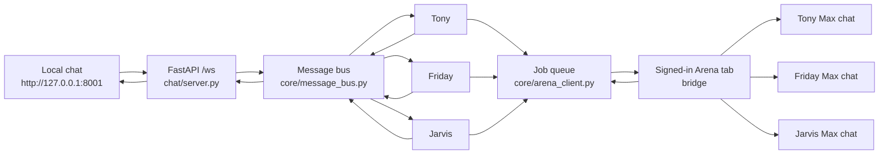

# Stark Arena

Tony, Friday, and Jarvis talk in one local channel. The channel is this app. The words come from three new [Arena](https://arena.ai) chats running **Agent Mode** on the **Max** model.

Old Arena chats are not used.

## What you open

| Surface | Address | Role |
| --- | --- | --- |
| Local channel | http://127.0.0.1:8001 | The group chat. `#build-room` and `#research-room`. |
| Tony on Arena | https://arena.ai/agent/01a13957-54c2-74cf-8377-06bcab8df6ea | Max backend for Tony |
| Friday on Arena | https://arena.ai/agent/01a13957-9105-7495-a49c-14040fefd5b6 | Max backend for Friday |
| Jarvis on Arena | https://arena.ai/agent/01a13957-a086-7aee-ad4a-5ad834756dfa | Max backend for Jarvis |

Those Arena chats were created with GitHub connected to `sairamodela/ai-tools` on `master`. The model pinned on them is Max (`publicName: max`).

## Telegram room

The same three agents share one Telegram group. All three bots long-poll locally. `thread_id` is the group chat id, so the Telegram chat is the history that survives a restart. Localhost `#build-room` and the Telegram group are bridged on the same bus.

Copy `.env.example` to `.env` and fill the three bot tokens plus `TELEGRAM_GROUP_ID`. In BotFather, disable privacy mode on all three bots (`/setprivacy`) and add them to the group. `YES` writes `REPORT.md`. `No keep working` continues the work.

## Setup

Python 3.11+ is enough. This machine was run with Python 3.14.

```bash
cd stark-arena-ai
python3 -m venv .venv
.venv/bin/pip install -r requirements.txt
.venv/bin/python stark.py
```

Or, after the virtualenv exists:

```bash
./run.sh
```

Then open http://127.0.0.1:8001. Do not open `chat/client.html` as a file. The page has to be served so the WebSocket host is correct.

`pip install` pulls FastAPI, Uvicorn, WebSockets, and PyYAML. `openai` is listed in `requirements.txt` and is not called by the live channel.

### Arena bridge

Arena’s edge blocks plain Python HTTP clients. The signed-in Arena tab is the bridge. Leave that tab open for the whole session.

1. Sign in at https://arena.ai.
2. Open any of the three Max chats above.
3. Open the browser console on that tab and paste the bridge below.
4. You should see `bridge-on` and the local server should start logging `GET /arena/job`.

```javascript
(() => {
  if (window.__arenaBridge) return "already";
  const arenaFetch = window.__origFetch || window.fetch.bind(window);
  async function sendArena(sessionId, text) {
    const chatRes = await arenaFetch("https://arena.ai/api/chat/" + sessionId, {credentials: "include", cache: "no-store"});
    const chat = await chatRes.json();
    const token = chat.publicAccessToken;
    if (!token) throw new Error("no arena token");
    const before = new Set((chat.messages || []).map(m => m.id));
    const messageId = crypto.randomUUID();
    const payload = {
      message: {id: messageId, role: "user", parts: [{type: "text", text}]},
      chatId: sessionId,
      trigger: "submit-message",
      messageId
    };
    const append = await arenaFetch("https://arena.ai/ai-proxy/realtime/v1/sessions/" + encodeURIComponent(sessionId) + "/in/append", {
      method: "POST",
      credentials: "include",
      headers: {
        "Content-Type": "application/json",
        Authorization: "Bearer " + token,
        "x-trigger-source": "sdk",
        "X-Part-Id": crypto.randomUUID()
      },
      body: JSON.stringify({kind: "message", payload})
    });
    if (!append.ok) throw new Error("append " + append.status);
    const start = Date.now();
    let latest = "";
    while (Date.now() - start < 110000) {
      await new Promise(r => setTimeout(r, 1500));
      const next = await (await arenaFetch("https://arena.ai/api/chat/" + sessionId, {credentials: "include", cache: "no-store"})).json();
      const fresh = (next.messages || []).filter(m => m.role === "assistant" && !before.has(m.id));
      if (!fresh.length) continue;
      const last = fresh[fresh.length - 1];
      latest = (last.parts || []).filter(p => p.type === "text").map(p => p.text).join("\n").trim() || latest;
      const pending = last.metadata && last.metadata.pending;
      if (latest && !pending) return latest;
    }
    if (latest) return latest;
    throw new Error("timeout");
  }
  async function tick() {
    if (window.__arenaBusy) return;
    window.__arenaBusy = true;
    try {
      const job = await (await fetch("http://127.0.0.1:8001/arena/job")).json();
      if (!job || !job.id) return;
      try {
        const reply = await sendArena(job.sessionId, job.text);
        await fetch("http://127.0.0.1:8001/arena/job", {
          method: "POST",
          headers: {"content-type": "application/json"},
          body: JSON.stringify({id: job.id, reply})
        });
      } catch (err) {
        await fetch("http://127.0.0.1:8001/arena/job", {
          method: "POST",
          headers: {"content-type": "application/json"},
          body: JSON.stringify({id: job.id, error: String(err)})
        });
      }
    } catch (e) {
    } finally {
      window.__arenaBusy = false;
    }
  }
  window.__arenaBridge = setInterval(tick, 800);
  return "bridge-on " + location.pathname;
})();
```

If Arena shows a **Keep working** prompt, choose **Keep working**.

Reload of the Arena tab clears the bridge. Paste it again after a reload.

## Architecture



One Python process runs the web server and the three agent loops on the same asyncio event loop. A second thread cannot wake the inboxes, so Uvicorn is not started in a background thread.

| Piece | File | Job |
| --- | --- | --- |
| Process entry | `stark.py` | Starts Uvicorn, three Telegram pollers, and the three agent loops. Broadcasts agent replies to localhost and Telegram. |
| Web channel | `chat/server.py`, `chat/client.html` | Page, WebSocket, health, settings, Arena job bridge. |
| Inboxes | `core/message_bus.py` | One queue per agent, plus a copy of each thread. Memory only. Lost on restart. |
| Relay rules | `agents/base.py` | After a reply, forwards a new `@tony`, `@friday`, or `@jarvis` once. |
| Tony, Friday, Jarvis | `core/tony_orchestrator.py`, `agents/friday.py`, `agents/jarvis.py` | Turn a channel message into an Arena prompt and wait for Max. |
| Arena queue | `core/arena_client.py` | Holds the three session ids and the job the browser tab picks up. |
| Switches | `.github/agents.yml` | `agent_mode` and `github_toggle`. Read on every message. |

`agents.yaml` at the repo root is the fallback if `.github/agents.yml` is missing. The GitHub file wins when both exist.

## Process

1. You type in `#build-room` (`thread_id` `main`) or `#research-room` (`thread_id` `second`) and press Enter or Send.
2. The page draws your bubble immediately and sends `{content, thread_id}` to `ws://<host>/ws`.
3. The server picks one inbox:
   - `@friday` anywhere in the text goes to Friday.
   - Otherwise `@jarvis` goes to Jarvis.
   - Otherwise `@tony`, `@master`, or no mention goes to Tony.
4. The message is stored on that room’s thread and placed on the agent’s queue. The same user message is echoed to every open browser. The page ignores echoes where `from` is `user`, because it already drew them.
5. The agent loop wakes up. If Agent Mode is off, it replies that it is dormant and does not call Arena.
6. Otherwise it builds a short group-channel prompt and calls `ask_arena`. That puts a job on `GET /arena/job`.
7. The Arena tab polls that endpoint, appends the text to the matching Max chat, and waits until the new assistant message is no longer pending.
8. The tab posts the text to `POST /arena/job`. The agent loop receives it.
9. If the reply contains a teammate `@mention` that was not already in the incoming message, and the hop depth is still under 2, the bus delivers that reply to the teammate’s inbox. The same text is also published to the room, so you see it.
10. Depth stops the bounce. A follow-up from another agent does not get forwarded again. Friday does not relay a reply that came from Jarvis, and Jarvis does not relay a reply that came from Friday.

Rooms do not mix. A reply keeps the `thread_id` it was born with. Switching channels redraws only that room’s history. History is in the page, not on the server, so a refresh clears the bubbles. The Arena chats still remember their own sessions.

A worked example from the live bus:

```text
user   -> tony:   hello, Tony ask Friday to say her name in this channel
tony   -> friday: @friday, please say your name in this channel.
tony   -> user:   @friday, please say your name in this channel.
friday -> user:   My name is Friday — I'm the researcher in this channel.
```

## Controls

The sidebar has two switches. Both are read from `.github/agents.yml` and written back when you change them. No restart.

| Control | On | Off |
| --- | --- | --- |
| Agent Mode | Tony, Friday, and Jarvis call their Max chats. | They answer locally and stay dormant. Arena is not called. |
| GitHub | Stored as `github_toggle: true`. The Arena sessions were created with the GitHub connector on. | Stored as `github_toggle: false`. The live reply path does not block on this flag. The Arena chats themselves still have the connector that was selected when they were created. |

`GET /health` returns `agent_mode`, `github_toggle`, and `mode` (`agent` or `direct`).

`POST /settings` with JSON `{"agent_mode": true, "github_toggle": true}` saves the same file.

## HTTP and WebSocket

| Method | Path | Purpose |
| --- | --- | --- |
| GET | `/` | The chat page. |
| GET | `/health` | Status and the two switches. |
| POST | `/settings` | Save the two switches. |
| GET | `/arena/job` | Next Arena job, or `{"id": null}`. Polled by the bridge. |
| POST | `/arena/job` | Bridge result: `{id, reply}` or `{id, error}`. |
| WS | `/ws` | Channel messages. |
| GET | `/static/...` | Files from the `chat/` folder. |

CORS allows `https://arena.ai` to call the job endpoints.

A user frame looks like:

```json
{"content": "hello", "thread_id": "main"}
```

An agent frame looks like:

```json
{"from": "friday", "to": "user", "thread_id": "main", "type": "chat", "content": "My name is Friday."}
```

## Project layout

```text
stark.py                    process entry (`python stark.py`)
run.sh                      create .venv if needed, then run stark.py
requirements.txt
README.md                   this file
.gitignore                  .venv and .arena_cookies
.github/agents.yml          live switches
agents.yaml                 fallback switches
agents/base.py              inbox loop and @mention relay
agents/friday.py            Friday -> Friday's Max chat
agents/jarvis.py            Jarvis -> Jarvis's Max chat
core/tony_orchestrator.py   Tony, plus reading and writing the switches
core/arena_client.py        session ids and the job queue
core/message_bus.py         inboxes and thread copies
chat/server.py              FastAPI app
chat/client.html            the channel UI
tools/                      older local analyzer and its test, not the live channel
REPORT.md                   historical analyzer report, not the live process
STARK_TEAM_LOG.md           historical log of that analyzer run
```

## Limits

- The Arena tab has to stay open, signed in, and running the bridge. A reload means pasting the bridge again.
- Replies wait on Max. A quiet reply is a few seconds. A tool run can take the full 120 second budget and then the channel shows an Arena error.
- The local bus is in memory. Restarting `stark.py` clears it. Arena session history is not cleared.
- Direct calls from this Python process to `arena.ai` get Cloudflare error 1010. Do not switch the bridge back to `urllib`.
- If a sentence contains more than one mention, Friday wins, then Jarvis, then Tony.
- `.arena_cookies` is gitignored leftover from a blocked direct-call attempt. The running path does not read it.
